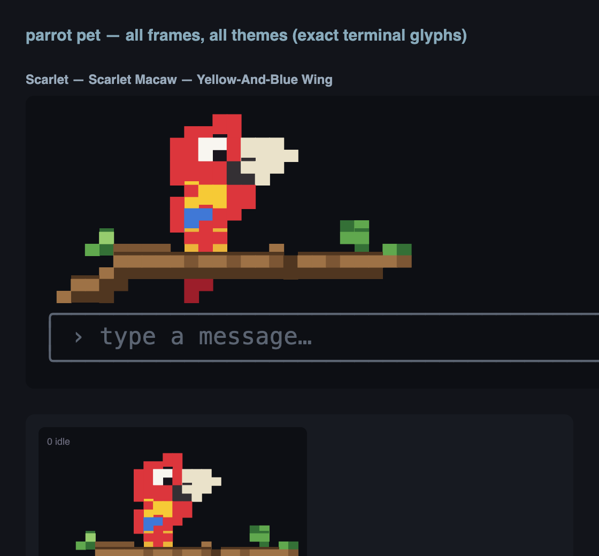

# Pirrot 🏴‍☠️

A pirate's kit for the [pi coding agent](https://github.com/earendil-works/pi): a pixel scarlet macaw that walks its branch while the model works, plus **multikey**, a local NVIDIA API key rotator that keeps pi sailing when one key hits its rate limit.



## What's aboard

| Piece | File | What it does |
| --- | --- | --- |
| Parrot pet | `extensions/parrot-pet.ts` | Replaces pi's editor with one that paints a truecolor pixel macaw into the bottom-right corner. It walks back and forth while the agent is working and sits still while idle. |
| Footer | `extensions/footer.ts` | Companion to the pet: model + thinking level bottom-left (thinking level in its own escalating color), tokens / context % / cost next to it. |
| Multikey extension | `extensions/multikey.ts` | `/multikey` key status, `/multikey-model` model picker, and auto-continue when a reply is cut off by the output token limit. |
| Rotator proxy | `multikey/nvidia-rotator.py` | Local OpenAI-compatible proxy on `127.0.0.1:8765` that forwards to NVIDIA and rotates across your keys. |
| Live dashboard | `multikey/multikey-status` | Full-screen, 1s-refresh table of every key: status, requests, tokens, credits, reset timers, burn rate. |
| Pet workshop | `parrot-pet/` | Sprite sources, version history and an HTML preview harness used to design the bird. |

## Install

Requires pi and, for multikey, Python 3.11+ (stdlib only, no pip installs).

```bash
git clone https://github.com/masluny/Pirrot.git
cd Pirrot
./install.sh               # everything, incl. a launchd service for the rotator on macOS
./install.sh --pet-only    # just the parrot + footer
./install.sh --no-service  # skip launchd; run `pi-nvidia serve` yourself
```

Then add your keys (one per line, from [build.nvidia.com](https://build.nvidia.com)) to `~/.pi/nvidia_keys.txt`, start pi (or `/reload`) and pick a model with `/multikey-model`.

The installer backs up any file it would overwrite, never touches an existing `nvidia_keys.txt`, and only adds the `nvidia-multikey` provider to `~/.pi/agent/models.json` if it isn't there yet.

## The parrot

```
/pet                    toggle
/pet on | off           perch / fly off (off restores pi's default editor)
/pet zoom <1-3>         downscale the sprite (1 = full detail)
/pet theme <name|next>  change morph — or just /pet <name>
```

Morphs: **scarlet** (default), **hyacinth**, **galah**, **synthwave**.

The bird is drawn with half-block characters (`▀`), two square pixels per terminal cell, in 24-bit color, so use a truecolor terminal (Ghostty, iTerm2, WezTerm, Kitty...). Animation only runs while the agent is streaming, so it never redraws under your typing, and any render error falls back to the normal editor.

## Multikey

```
pi ──► 127.0.0.1:8765 (nvidia-rotator.py) ──► integrate.api.nvidia.com/v1
                 │
                 ├─ picks the least-recently-used key under the 40 RPM cap
                 ├─ 429      → cooldown from Retry-After / x-ratelimit headers,
                 │             else escalating 60s → 30min, retry on next key
                 ├─ 402 / "credit"/"quota" body → benched 7 days (free credits are one-time)
                 ├─ 401/403  → benched 1h, 30 days after 3 in a row
                 ├─ no response headers in 20s → 90s cooldown, try next key
                 └─ streams SSE straight through, counts tokens per key
```

State (counters, cooldowns) lives in `~/.pi/nvidia_keys_state.json`, guarded by a file lock so CLI commands can't race the running proxy.

**In pi**

- `/multikey` shows how many keys are available, with usage per key.
- `/multikey-model [name]` switches the model live (interactive picker without an argument; ⚡ marks reasoning models). It rewrites `models.json` and `settings.json` for you.
- When a reply stops with `stopReason: "length"`, the extension asks the model to continue where it left off, up to 5 times in a row.

**In the shell**

```
pi-nvidia serve          run the proxy (the launchd service does this for you)
pi-nvidia status         per-key usage + reset table
pi-nvidia keys           list loaded keys (masked)
pi-nvidia reset [index]  clear cooldowns + counters for one key or all
pi-nvidia test           ping every key with a 1-token request
multikey-status          live dashboard (q to quit; --once for a single snapshot)
```

Tunables via env vars: `PI_NVIDIA_UPSTREAM_TIMEOUT` (20s), `PI_NVIDIA_TIMEOUT_COOLDOWN` (90s), `PI_NVIDIA_TOTAL_DEADLINE` (45s), `PI_NVIDIA_MAX_TIMEOUT_ATTEMPTS` (2), `PI_NVIDIA_TEST_TIMEOUT` (12s).

## Uninstall

```bash
launchctl bootout gui/$(id -u)/com.pi.nvidia-rotator
rm ~/Library/LaunchAgents/com.pi.nvidia-rotator.plist
rm ~/.pi/agent/extensions/{parrot-pet,footer,multikey}.ts
rm ~/.pi/nvidia-rotator.py ~/.pi/multikey-status
```

Then remove `nvidia-multikey` from `~/.pi/agent/models.json` and delete `~/.pi/nvidia_keys*` if you want your keys gone too.
